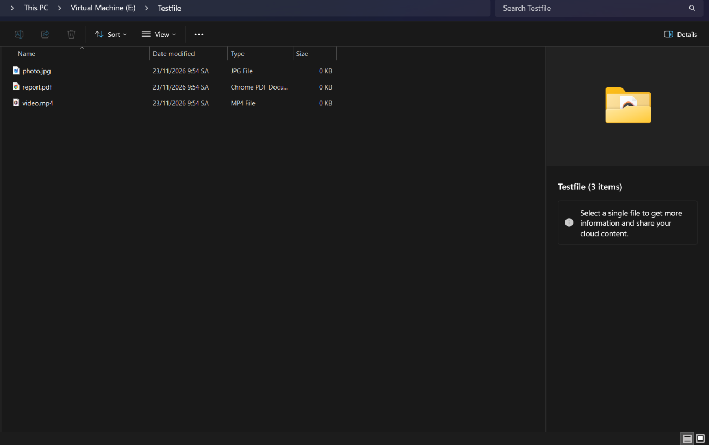
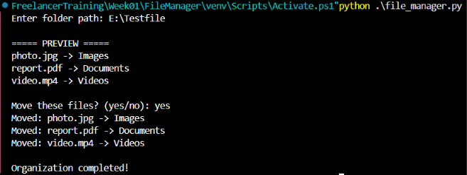
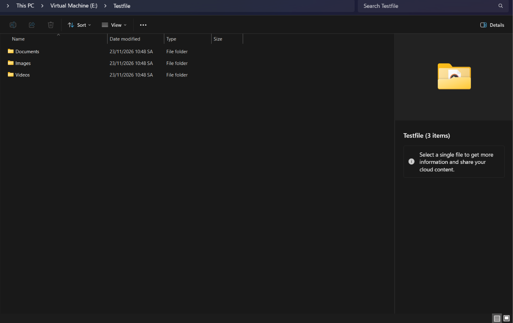

# File Manager Automation

A Python tool that automatically organizes files
into folders based on their file extensions.

## Features

- Scan folders and detect files.
- Classify files by extension.
- Organize files into categories.
- Preview before moving files.
- Prevent overwriting existing files.
- Handle file operation errors.
- Record activities using logging.

## Categories

| Category | Extensions |
|---|---|
| Documents | PDF, DOCX, TXT |
| Images | JPG, JPEG, PNG |
| Videos | MP4, MKV, AVI |
| Spreadsheets | XLSX, XLS, CSV |
| Others | Other extensions |

## Technologies

- Python 3.11+
- pathlib
- shutil
- logging

## Installation

Clone the repository:

```bash
git clone https://github.com/chienchief/FileManager-Automation.git
```

Enter the project folder:

```bash
cd FileManager-Automation
```

Run the application:

```bash
python file_manager.py
```

## Usage

1. Enter the folder path.
2. Review the file organization preview.
3. Enter `yes` to confirm.
4. Files will be moved into categorized folders.

## Project Status

Learning project – continuously improving.


## Demo

### 1. File Preview


### 2. File Organization


### 3. Organized Result


